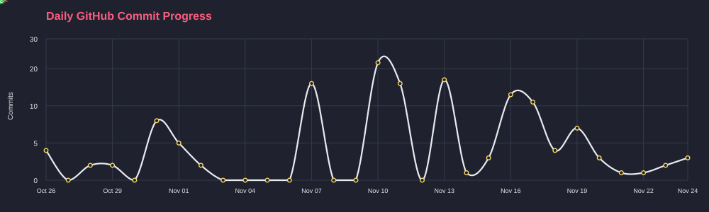

  

  
  
    
    
  
  
  
  
  

---

<h1 align="center"> About Me </h1>

I am a Computer Science and Engineering graduate from IUBAT, specializing in Software Engineering and Software Development Engineering in Test (SDET). I am passionate about designing and developing reliable software solutions while ensuring application quality through structured testing and automation. My development experience includes JavaScript, TypeScript, React, Python, FastAPI, SQLAlchemy, and PostgreSQL, which I use to build web applications, RESTful APIs, and database-driven systems. I also leverage AI-powered coding agents to support software development, accelerate implementation, and improve development workflows.

My approach to software quality focuses on understanding application behavior, validating functionality, and identifying potential defects through systematic testing. I work across manual and automation testing, applying black-box, gray-box, and white-box testing approaches. My testing practices include functional, integration, regression, and API testing, with an emphasis on test case design, business logic validation, edge-case analysis, and defect identification. I use Postman for API testing, Playwright for browser automation, and Mocha and Chai for API integration testing, focusing on building effective test scenarios and improving application reliability.

Currently, I am expanding my knowledge of Docker, containerization, application deployment, Linux, CI/CD, and DevOps practices to strengthen my understanding of the software delivery lifecycle. I believe software quality is not limited to testing; it is an essential part of every stage of software engineering, from design and development to testing and deployment. By combining software development, quality engineering, and test automation, I aim to contribute to building scalable, maintainable, and dependable software solutions.

Beyond the technologies, my philosophy as an engineer is simple. I develop with purpose, test with precision and automate for quality.

---

<h1 align="center"> Technologies & Tools I Work With </h1>

  
| Cat | Technologies |
|:---:|:------------:|
| **Programming Languages** |      |
| **Frontend** |       |
| **Backend** |       |
| **Database** |   |
| **Tools** |         |
| **Testing** |        |
| **Currently Exploring** |      |

---

<h1 align="center"> Systems I Have Built </h1>

<table>

<!-- Row 1 -->
<tr>

<td width="50%" valign="top">

<h3 align="center"> School Management System</h3>

Role-based school management system with dedicated workflows for administrators, teachers, students, and guardians — covering students, teachers, guardians, classes, subjects, attendance, exams/results, fees, assignments, and reports.

✔ Role-based access (admin / teacher / student / guardian)  
✔ Attendance, exams &amp; results  
✔ Fees, assignments &amp; reports

</td>

<td width="50%" valign="top">

<h3 align="center"> ReSale Marketplace</h3>

High-end, secure resale marketplace for pre-owned electronics in Bangladesh — built on trust and transparency with Escrow Protection, real-time negotiation, and a premium user experience.

✔ Escrow protection system  
✔ Real-time negotiation via WebSockets  
✔ Responsive glassmorphism UI

</td>

</tr>

<!-- Row 2 -->
<tr>

<td width="50%" valign="top">

<h3 align="center"> StayEase Resort Management</h3>

Modern cloud-based resort management system for bookings, operations, and guest management.

✔ Bookings &amp; reservation management  
✔ Stripe + bKash / Nagad / Rocket payments  
✔ Audit logging, Prometheus &amp; Sentry

</td>

<td width="50%" valign="top">

<h3 align="center"> Smart Calculator</h3>

Full-stack scientific calculator with modern and clean UI.

✔ Authentication &amp; JWT  
✔ User-specific history  
✔ Dark / Light mode

</td>

</tr>

</table>

---

<h1 align="center"> My Development Approach </h1>

 

📌 <b>Plan</b> → 🧩 <b>Design</b> → 💻 <b>Develop</b> → 🧪 <b>Test</b> → 🚀 <b>Deploy</b> → 🔁 <b>Iterate</b>
  
I follow an Agile development methodology that emphasizes iterative delivery, continuous feedback, and ongoing improvement. My approach combines clean architecture and scalable system design with a strong focus on reliability, maintainability, and delivering production-ready solutions that can adapt to evolving requirements.

---

<!-- ══════════════════════════════════════════════════════════════════════ -->
<!--              HIRE ME                          -->
<!-- ══════════════════════════════════════════════════════════════════════ -->
<h1 align="center"> HIRE ME </h1>

If you are seeking a Full-Stack Developer or Software Engineer with a strong foundation in designing and building scalable, high-performance applications, writing clean and maintainable code, and developing well-structured systems with a focus on reliability and long-term sustainability, I would welcome the opportunity to connect.
 
My contact links are provided below — feel free to reach out and connect.
 

---

<h1 align="center"> GitHub Analytics & Contribution Graph </h1>

   

  <!-- GitHub Streak -->
  

    
  

  
  <!-- GitHub Stats and Top Languages with Theme Support -->
  <picture>
    <source 
      srcset="https://github-readme-stats-gamma-lilac.vercel.app/api?username=AonontoJahan&show_icons=true&theme=react&hide_border=true&bg_color=1F222E&title_color=F85D7F&icon_color=F8D866" 
      media="(prefers-color-scheme: dark)" />
    
  </picture>

  <picture>
    <source 
      srcset="https://github-readme-stats-gamma-lilac.vercel.app/api/top-langs/?username=AonontoJahan&layout=compact&theme=react&hide_border=true&bg_color=1F222E&title_color=F85D7F&icon_color=F8D866&langs_count=8&hide=kvlang%2Cmakefile&size_weight=0.5&count_weight=0.5" 
      media="(prefers-color-scheme: dark)" />
    
  </picture>

<!--Daily Activity Graph -->

  

---

<h1 align="center"> Beyond the Code </h1>

My favorite language is Python — and definitely not the snake.

I genuinely enjoy designing clean, elegant and intuitive interfaces — good UI just feels right.

Debugging feels like solving a mystery — except I’m both the detective and the one who caused it.

I once spent 3 hours automating a 5-minute of task and honestly, it was absolutely worth it for me.

I often find myself talking to computers more than people — and surprisingly, they respond much better.

---

  <em>"The best code is simple, readable, and built to last."</em>

  

